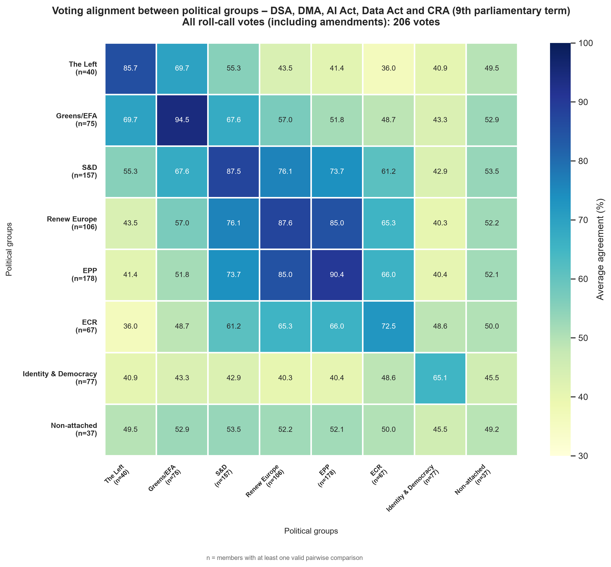
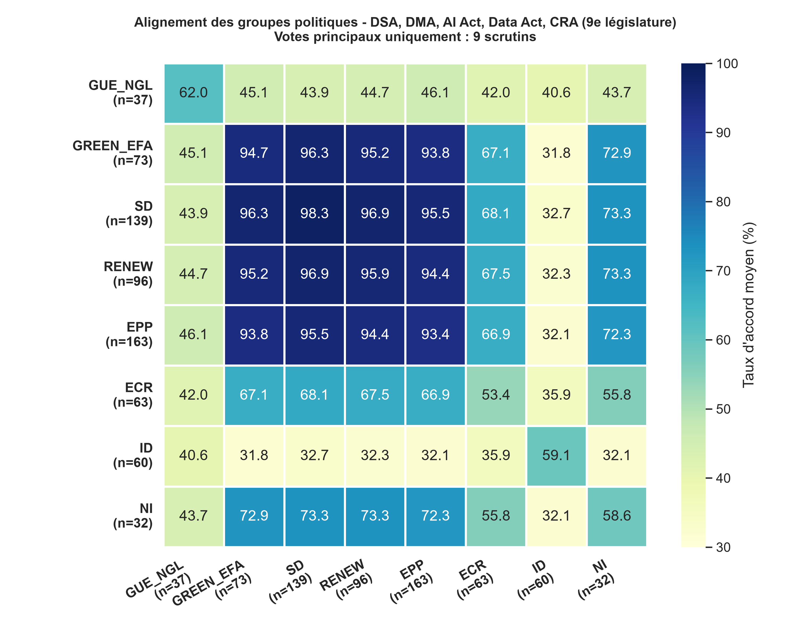

# EU Parliament: Digital Coalitions

How do political groups in the European Parliament vote when regulating the digital economy? This project tracks voting patterns across the five landmark digital laws of the 9th parliamentary term (2019–2024)—the **DSA, DMA, AI Act, Data Act, and Cyber Resilience Act**—to measure how often MEPs vote together and how coalitions form across party lines.

> **Full methodology, mathematical definitions, and limitations:** see [methodology.md](docs/METHODOLOGY.md).  
> *Note: Agreement scores measure observed behavioural similarity in roll-call votes, not direct ideological proximity or formal political alliances.*

## Key Findings




* **A Resilient Centrist Supermajority on Final Texts:** On main votes (9 scrutinies), the core pro-European groups (**Greens/EFA, S&D, Renew, and EPP**) operate as a unified legislative bloc, with pairwise agreement rates ranging between **93.4% and 98.3%**.
* **Ideological Granularity in Amendments:** When expanding the scope to all recorded votes (206 scrutinies, including committee and plenary amendments), consensus fractures along traditional left–right lines. While the **EPP–Renew** axis holds steady at **85.0%**, agreement between **EPP and Greens/EFA** drops from **93.8%** to **51.8%**.
* **Internal Discipline vs. Right-Wing Fragmentation:** Mainstream groups display strong internal voting cohesion across all scrutinies (**Greens/EFA at 94.5%**, **EPP at 90.4%**, **Renew at 87.6%**, **S&D at 87.5%**). Conversely, **ECR (72.5%)** and **ID (65.1%)** exhibit significantly lower internal discipline, with **ID** remaining largely isolated from the regulatory consensus (under **36%** agreement with other groups on main votes).

## Data Source

Roll-call voting records are sourced from [HowTheyVote.eu](https://howtheyvote.eu) ([HowTheyVote/data](https://github.com/HowTheyVote/data)) and downloaded automatically by the pipeline. Please refer to their repository for licensing and attribution requirements.  
*Dataset snapshot date: 2026-11-14.*

## Pipeline & Usage

```bash
pip install -r requirements.txt

python src/01_clean_data.py
python src/02_similarity.py
python src/03_group_heatmap.py